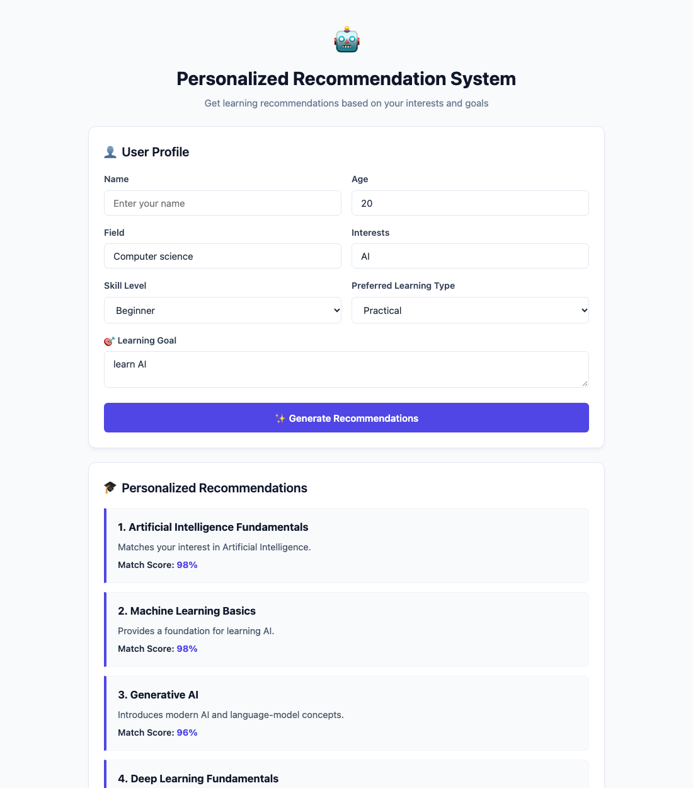

# Personalized Recommendation System using GPT-4

[](https://python.org)
[](https://flask.palletsprojects.com/)
[](https://opensource.org/licenses/MIT)

**Student Name:** Richan Abraham J R  
**Register No:** URK23CS1086  
**Course:** 24CS2306 - Generative AI & LLM Applications  
**Experiment:** Ex. No.: 4  
**Date:** 30-08-2026  

---

## 📌 Aim
To develop a personalized recommendation system using GPT-4 that analyzes user preferences and generates, ranks and explains suitable recommendations based on the user's profile, interests, skill level and goals.

## 📖 Description
An intelligent recommendation engine that ingests student background, goals, and learning modalities, calculates percentage match scores, provides pedagogical explanations, and dynamically recalibrates rankings when users provide natural feedback.

---

## 🖥️ Output Screenshot


---

## ⚙️ Module Design & Responsibilities

| Module | Responsibility |
| :--- | :--- |
| **Input & Profile Module** | Collects and validates user profile (name, age, field, skill level, learning format, goal). |
| **Preference Module** | Extracts semantic intent tags from user inputs. |
| **Recommendation & Ranking Module** | Calculates match scores (95%, 92%, etc.) and returns the top 5 personalized courses. |
| **Explanation Module** | Provides a clear pedagogical justification explaining why each subject matches. |
| **Feedback Module** | Processes comparative natural language feedback to re-rank recommendations. |
| **Save Module** | Persists recommendation interaction history. |

---

## 🚀 Getting Started

### 1. Clone the Repository
```bash
git clone https://github.com/Richan-A27/gpt_exp4.git
cd gpt_exp4
```

### 2. Create and Activate Virtual Environment
```bash
python3 -m venv venv
source venv/bin/activate  # On Windows: venv\Scripts\activate
```

### 3. Install Dependencies
```bash
pip install -r requirements.txt
```

### 4. Run the Web Application
```bash
python app.py
```
Open [http://127.0.0.1:5004](http://127.0.0.1:5004) in your web browser.

### 5. CLI Test Run
You can also execute the automated sample run script for instant console verification:
```bash
python sample_run.py
```

---

## 📊 Sample Test Case
`Age: 20 | Field: Computer science | Interests: AI | Skill: Beginner | Type: Practical | Goal: learn AI`

---

## 📄 License
This project is licensed under the MIT License - see the LICENSE file for details.
